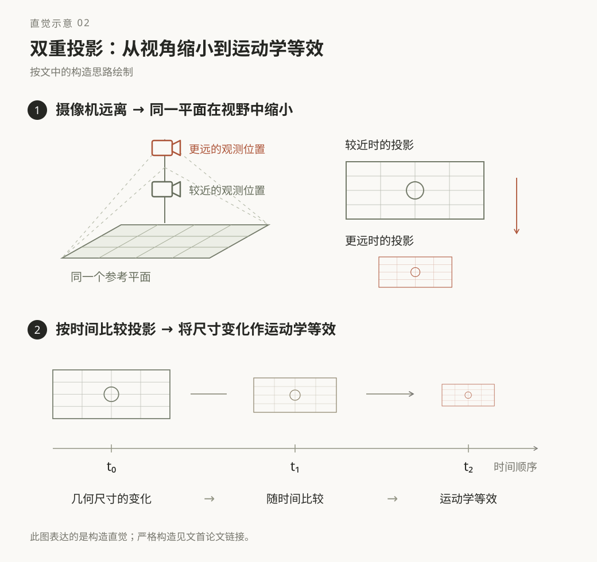

今天我们要介绍一个高中生原创的极具突破性的思想的构造过程，成果已经投稿在 https://doi.org/10.6084/m9.figshare.34883151 上，并且正在交由 PRD 评审。

## 1 尺度相对性

现代基础物理学的核心矛盾在于大尺度宇宙学到广义相对论到量子物理的矛盾，其核心是尺度。因此我们从第一性原理思考，问题绝对和尺度有关，这是问题的第一个马脚。接下来是最重要的第二个马脚：我们知道惠勒-德威特方程，即：

$$
\hat{H}\lvert\psi\rangle = 0
$$

即从量子引力的全局视角来看，宇宙的整体状态是静态的、不包含显式的时间变量。我们还知道大尺度宇宙下的膨胀正在加速，和 EdS，也就是广义相对论中爱因斯坦场方程的一个宇宙学标准数学解，存在冲突。（我不相信暗能量和暗物质的存在，这和上世纪的被相对论推翻的以太假说很像。）于是我开始进行最初的构造：越小，时间流速越慢。越大，时间流速越快？但是很明显这不管用，因为整体时间流速变快，宇宙仍然在减速膨胀。另外，时间流速并没有一个标准，它具有“加速对称性”，也就是世界上所有时间都加速一百倍，那么没人能察觉，需要外部参考基准，空间也是。这个直觉很重要，直接导出了后期的核心理论。那么这样构造显然是不行的，怎么办呢？我突发灵感，万一大尺度的时间流速具有加速度呢？那不就可以让宇宙的膨胀从减速变成加速了吗？之后，我接着构造：时间是不可能无缘无故具有加速度的，唯一的可能就是小尺度的人类观测到大尺度结构的时候，具有一种尺度的相对性，而这种相对性诱导了宇宙的加速！也就是宇宙本身是减速膨胀的，但是因为人类从小尺度观测大尺度，这种相对性让宇宙在人类的观测视角下看起来是加速的！想象一个赛车减速的视频，如果你不停的把播放的倍速调大，那么这个赛车看起来就是在加速！这是一个极其美妙的构造。不同系统之间的尺度不同，相对的时间流速的加速度也不同，而惠勒-德威特方程告诉我们极微观下没有时间，因为根本没有尺度！

<figure class="note-figure">
  
  <figcaption>图 1 · 赛车与播放时钟。点击图片可放大查看。</figcaption>
</figure>

## 2 相对性原理

那么如何构造才能让尺度之间的相对性带有天生的时间加速度呢？由于我非常崇尚第一性原理思维和简洁之美，所以我认为我们可以效仿爱因斯坦。伟大的理论通常可以用极其简单的思想实验推导出，例如时间膨胀和勾股定理的关系。我们需要得到的结果和爱因斯坦当年导出的时间膨胀差不多，都是一种会让类时方向扩张的变换。当年他怎么推导的？光子钟实验加上光速不变！如果你问我这个思想实验的精髓，那绝对是光速不变，因为光速不变导致了在 $d$ 一样的情况下只能变 $t$！光速不变这种反直觉的原理必然导出一些反直觉的理论，因为反直觉的原理给出了限制。同样，我们能用光速不变推导尺度相对性，构造带有尺度版本的光子钟思想实验（我相信这样伟大的理论可以靠初等数学和这样基本的思想实验导出）吗？当然可以！在一个月后，我突然灵光一闪：还记得我说的，“时间流速并没有一个标准，它具有‘加速对称性’，也就是世界上所有时间都加速一百倍，那么没人能察觉，需要外部参考基准，空间也是”吗？空间放大一百倍，是不是具有放缩对称性？无法区分？是的！空间放大一百倍，是不是光速还是不变？是的！但是我们面临两个问题：1 凭什么空间的放大是尺度的放大？不是放大无法区分吗？2 空间的放大是一种几何变换，他是超光速的，无论如何都成立的。怎么解决？先来解决第二个问题。我的脑子里突然涌现出一种运动学框架：要想让这个几何变换被光速不变限制，也就是遵循洛伦兹变换，需要给这个几何变换一个运动学过程。如何给他一个运动学过程？限制他的速度！问题是你凭什么限制他的速度？我突然想到，一个点，他的光锥之内才存在因果，你无法获取到光锥之外的信息！也就是尺度可以超光速放大，但获取信息的速度被光速牢牢拴住！所以我们可以限制尺度放大的速度为光速！怎么定义尺度放大的速度？我把空间升维，让一个摄像机在另一个领域用光速远离，代表了光锥的边界不就行了吗！这个摄像机远离的速度是光速，因此有了运动学过程！远离的时候，平面在你眼里缩小，我们根据运动的定义（位置在不同时间发生变化）来把这种几何上的缩小等效成运动，于是可以套用洛伦兹变换，于是尺度放缩给出了狭义相对论的修正！至此，相对性原理构造完毕。

<figure class="note-figure">
  
  <figcaption>图 2 · 双重投影的构造直觉。点击图片可放大查看。</figcaption>
</figure>

## 3 理论完善

这里要感谢 ChatGPT 带着我一起把这个理论从一个扩展版本的洛伦兹变换构造成一个完整的类洛伦兹变换群，还原了完整的数学结构（GPT 虽然在我不停的修正下才明白了我的两轮变换，但还是数学严父），前两章的思考是晚上进行了空间放缩对称性的铺垫性思考后，凌晨一点突然来灵感了开始在纸上推导得到的，后面两点半的时候差不多推导完毕，然后让 GPT 跑观测数据。我本来是不抱有希望的，因为我每天都会想出好几个 Idea 然后给 GPT 验证，一般都是大偏离。真正让我激动的是 GPT 表示超新星数据拟合结果和 $\Lambda\mathrm{CDM}$ 完全一致！！！我的零参数模型和凑参数的 $\Lambda\mathrm{CDM}$ 模型完全一致，这让我坚信我的理论是正确的，于是我立刻写成了论文在一周之后投稿 PRD，随后在此记录下了我的思考。

这只是一个模糊的研究笔记，介绍我的心路历程。严格构造与论文已经写好，请查看开头链接。

